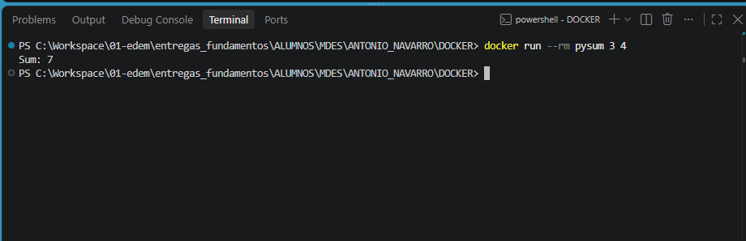

# Suma con Docker

Desde esta carpeta, construye y ejecuta la imagen:

```bash
docker build -t pysum .
docker run --rm pysum 3 4
```

El resultado esperado es `Sum: 7`.

## Captura de la ejecución


