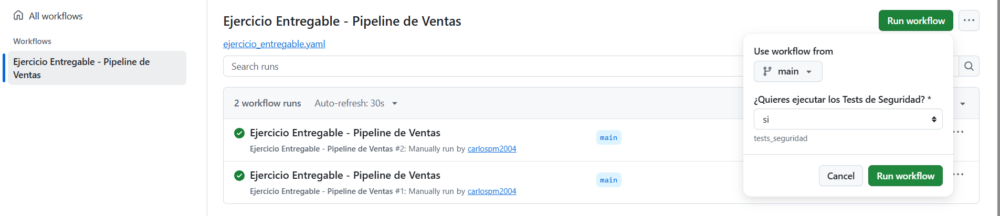
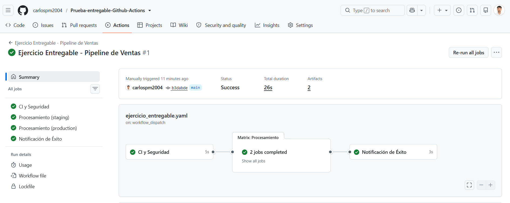
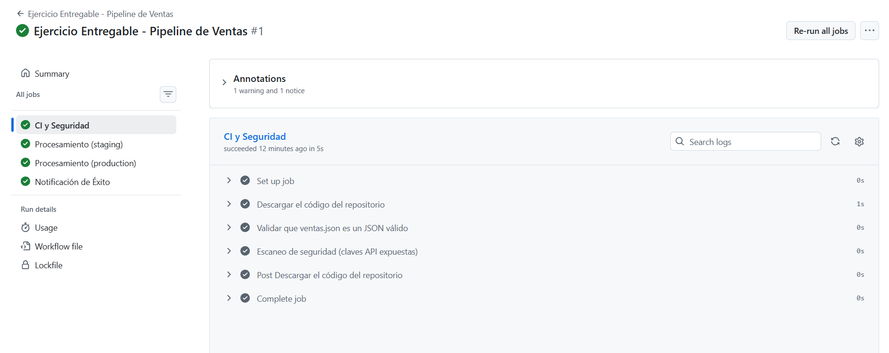
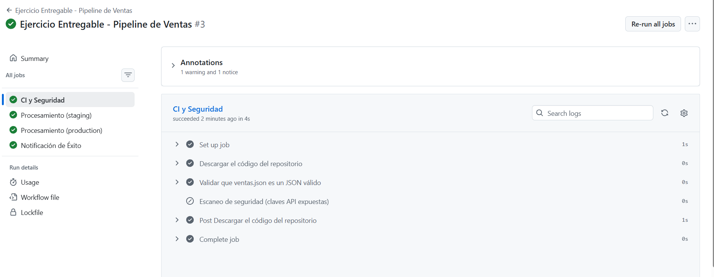
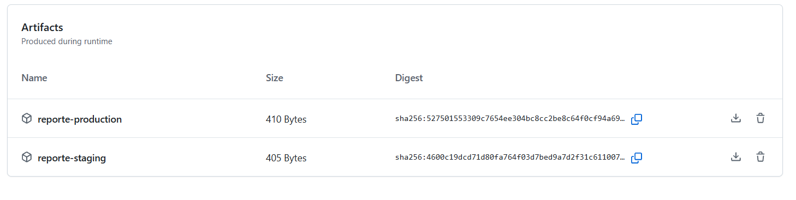
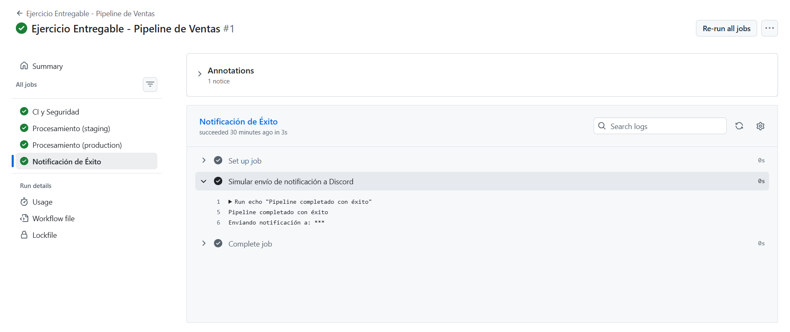

# Ejercicio Final: Pipeline de Datos Seguro y Automatizado

## 1. Activación manual
Al pulsar *Run workflow* se elige si ejecutar los Tests de Seguridad.

## 2. Resumen de la ejecución
Los cuatro jobs terminan bien. La matrix lanza el procesamiento en staging y production.

## 3. Tests de seguridad activados ("si")
Se valida el JSON y se ejecuta el escaneo de seguridad.

## 4. Tests de seguridad desactivados ("no")
Se valida el JSON, pero el escaneo se salta.

## 5. Artefactos
Un reporte por entorno, disponible para descargar.

## 6. Notificación de éxito
El secreto `DISCORD_WEBHOOK` aparece enmascarado como `***`.

