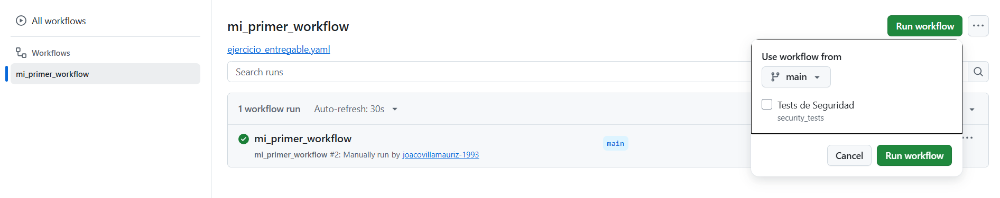
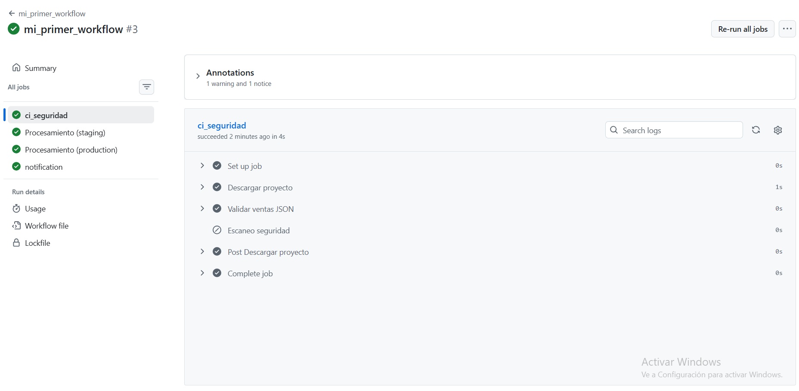
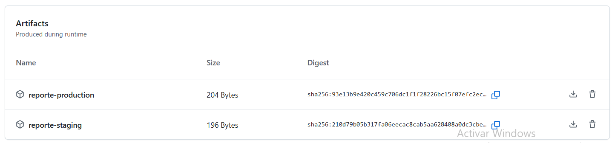
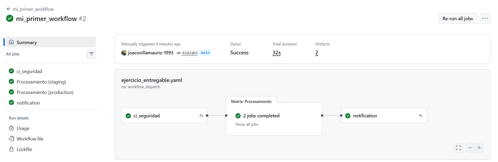

# Evidencias de Ejecución - GitHub Actions
**Alumno:** Joaquín Villalobos

## 1. Disparo Manual e Inputs (`workflow_dispatch`)
Se configuró el evento `workflow_dispatch` para permitir la activación manual del flujo desde la interfaz de GitHub Actions, incluyendo el parámetro de entrada `security_tests` de tipo booleano (casilla de verificación).

---

## 2. Evaluación de Lógica Condicional (`if`)
El paso *Escaneo seguridad* evalúa la condición `if: inputs.security_tests == true`. 

* **Casilla desmarcada (`false`):** El motor de GitHub Actions omite el paso de escaneo (*Skipped*), continuando con el resto del job sin fallar.

* **Ejecución del Job de CI:** Al ejecutarse con normalidad, se valida la estructura del archivo `ventas.json` mediante `jq`.

---

## 3. Matriz de Ejecución en Paralelo (`matrix`)
El job `procesamiento` utiliza una estrategia de matriz para ejecutar de forma simultánea los entornos de `staging` y `production`.

---

## 4. Generación y Almacenamiento de Artefactos
Cada trabajo de la matriz genera un informe individualizado y lo sube al almacenamiento temporal de GitHub mediante la acción `actions/upload-artifact@v4`.

---

## 5. Gestión de Secretos y Enmascaramiento
En el job `notification`, la variable de entorno toma la URL guardada en `secrets.DISCORD_WEBHOOK`. En la salida de consola se verifica el enmascaramiento automático (`***`), garantizando que los datos sensibles no queden expuestos en texto plano.

---

## 6. Flujo Completo y Grafo de Dependencias (DAG)
Ejecución exitosa de los 3 jobs en secuencia (`ci_seguridad` $\rightarrow$ `Matrix: Procesamiento` $\rightarrow$ `notification`), cumpliendo con la dependencia `needs`.

