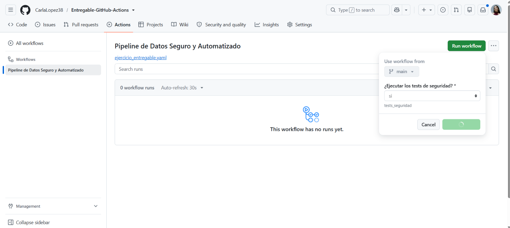
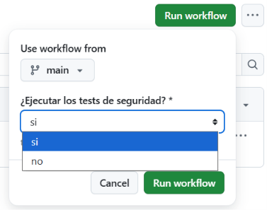
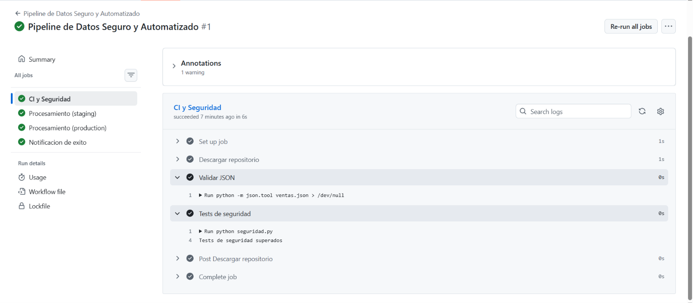
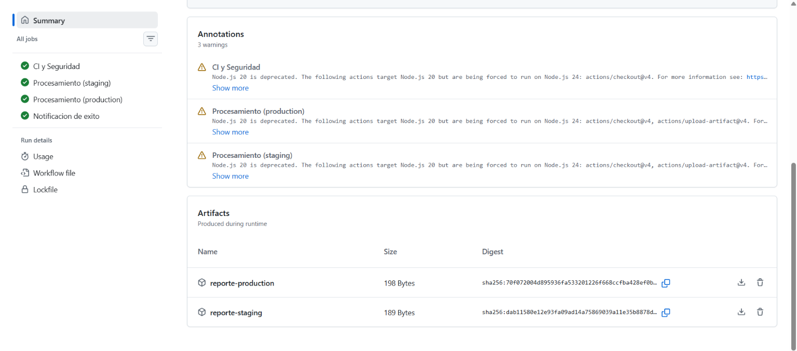
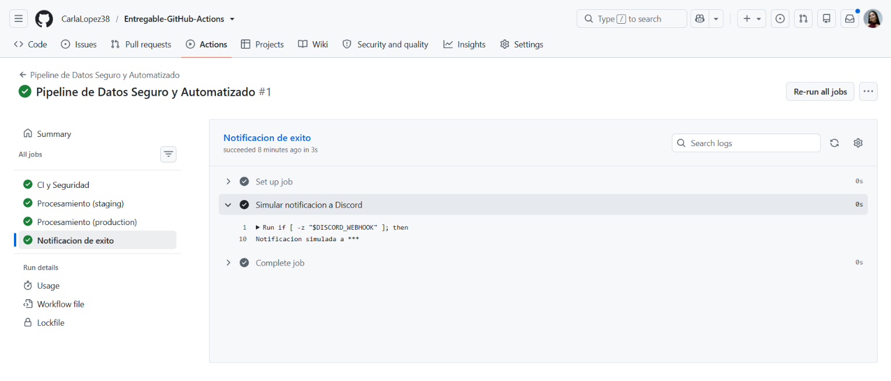
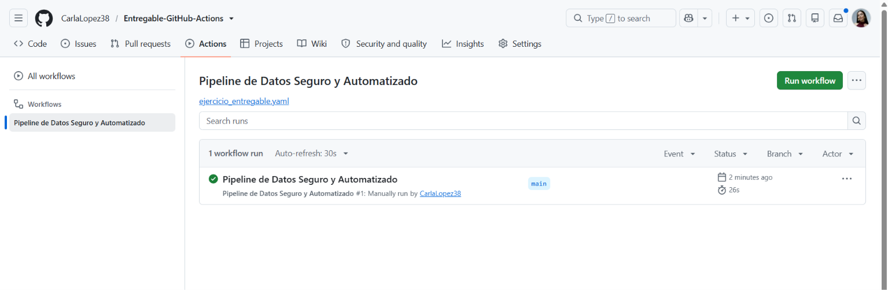
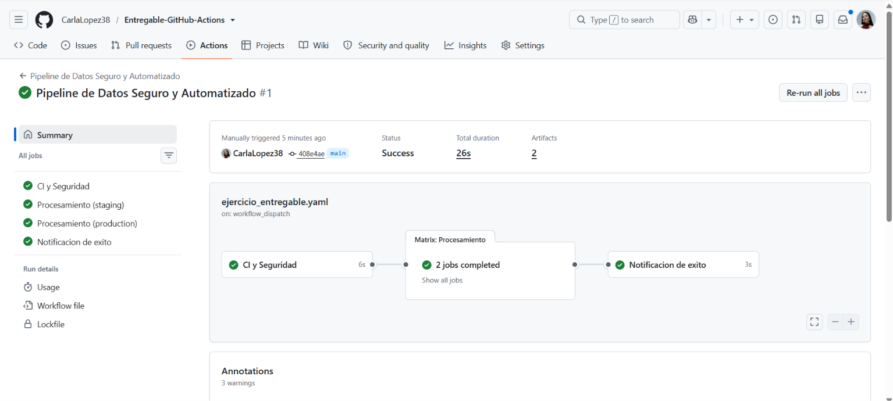
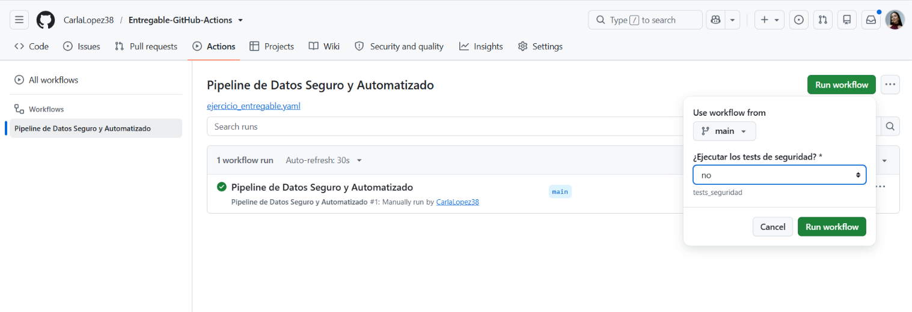
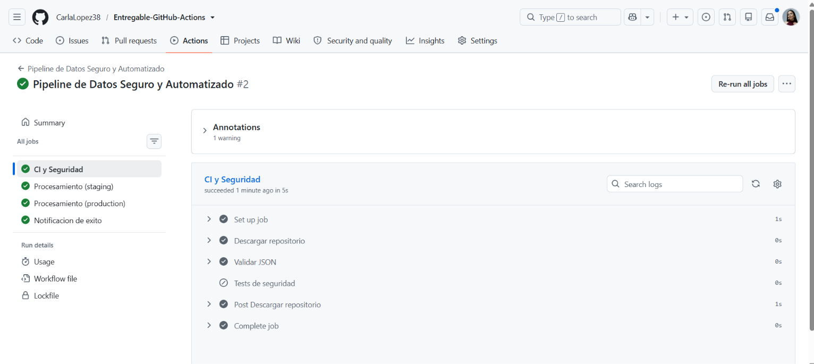

# Ejercicio Final: El Pipeline de Datos Seguro y Automatizado

## Objetivo

Automatizar un proceso de validación, seguridad y procesamiento de datos de ventas en formato JSON mediante GitHub Actions.

## Archivos del ejercicio

- `.github/workflows/ejercicio_entregable.yaml`: configuración del workflow.
- `seguridad.py`: script de Python que simula un escaneo de seguridad.
- `ventas.json`: datos de ventas utilizados para las pruebas.
- `fotos/`: capturas de pantalla del funcionamiento del workflow.

## 1. Activación manual

El workflow se activa manualmente mediante `workflow_dispatch`.

Se ha definido un input llamado `tests_seguridad` que permite al usuario elegir si desea ejecutar los tests de seguridad.

Las opciones disponibles son `si` y `no`, siendo `si` la opción seleccionada por defecto.

## 2. Job 1: CI y Seguridad

El primer job se ejecuta en una máquina virtual con `ubuntu-latest` y realiza los siguientes pasos:

1. Descarga los archivos del repositorio mediante `actions/checkout`.
2. Comprueba que el archivo `ventas.json` tiene un formato JSON válido mediante `python -m json.tool`.
3. Ejecuta el script `seguridad.py` únicamente si el usuario ha seleccionado `si`.

El script de Python simula un escaneo de seguridad buscando la palabra `api_key` en el archivo de ventas. Si encuentra una posible clave API expuesta, finaliza con un código de salida 1, indicando que el test ha fallado.

En la primera ejecución se comprueba que el JSON es válido y que los tests de seguridad se superan correctamente.

## 3. Job 2: Procesamiento

El segundo job depende del primero mediante `needs: ci_seguridad`, por lo que solo se ejecuta si el job anterior ha terminado correctamente.

Se utiliza una Matrix para simular el procesamiento en dos entornos:

- `staging`: entorno de pruebas.
- `production`: entorno de producción.

Cada ejecución genera un archivo de reporte diferente:

- `reporte_staging.txt`
- `reporte_production.txt`

Los reportes se generan mediante el comando `echo` y se suben como artefactos utilizando `actions/upload-artifact@v4`.

De esta forma, los archivos quedan disponibles para su descarga una vez finalizado el workflow.

## 4. Job 3: Notificación de éxito

El último job depende de los dos anteriores mediante `needs`, por lo que únicamente se ejecuta si ambos han terminado correctamente.

Para simular el envío de una notificación a Discord, se ha creado un secreto en GitHub llamado `DISCORD_WEBHOOK`.

El secreto se recupera mediante una variable de entorno, sin almacenar su valor directamente en el código.

Además, se comprueba que el secreto esté configurado antes de ejecutar la notificación.

Como se observa en la siguiente captura, GitHub enmascara el valor del secreto mediante asteriscos.

## 5. Pruebas de funcionamiento

Se han realizado dos ejecuciones del workflow para comprobar el funcionamiento de la condición de los tests de seguridad.

### 5.1. Primera ejecución: tests de seguridad activados

Se ejecuta el workflow seleccionando `si`.

La ejecución finaliza correctamente.

En el siguiente diagrama se observa el orden de ejecución de los jobs, sus dependencias y las dos ejecuciones del job de procesamiento generadas mediante la Matrix.

### 5.2. Segunda ejecución: tests de seguridad desactivados

Se ejecuta nuevamente el workflow seleccionando `no`.

En esta ejecución se comprueba que el paso de los tests de seguridad se omite, mientras que la validación del JSON y el resto de los jobs finalizan correctamente.

## Conclusión

Las dos ejecuciones han finalizado correctamente, verificando el funcionamiento de la activación manual, los tests condicionales, las dependencias entre jobs, la Matrix, la generación de artefactos y el uso de secretos.

## Repositorio de ejecución

El workflow se ha desarrollado y ejecutado en el siguiente repositorio personal de GitHub:

[Entregable-GitHub-Actions](https://github.com/CarlaLopez38/Entregable-GitHub-Actions)
