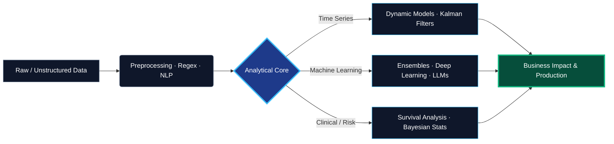

<!-- ======================= HEADER ======================= -->
<div align="center">


<a href="https://github.com/CarlosCandela02">
  
</a>

<br/><br/>

<a href="https://www.linkedin.com/in/carlos-candela-giner-70126430a/"></a>
<a href="mailto:candelaginercarlos@gmail.com"></a>


</div>

<br/>

---

## `01.` // The Core Philosophy

> I build AI systems grounded in strict mathematical theory — **convergence, probabilistic modeling and uncertainty propagation** — to solve real business and engineering problems.

$$
\hat{x}_{k|k} = \hat{x}_{k|k-1} + K_k\left(z_k - H_k\,\hat{x}_{k|k-1}\right), \qquad
K_k = P_{k|k-1}H_k^\top\left(H_k P_{k|k-1}H_k^\top + R_k\right)^{-1}
$$

*The Kalman filter update: optimal decisions require continuously revising our beliefs as new data arrives.*

<table>
<tr>
<td width="55%" valign="top">

```python
class CarlosCandela(DataScientist):
    education = {
        "BSc":  "Mathematics · Universitat de València",
        "BSc ": "Biomedical Engineering",
        "MSc":  "Business Management",
        "MSc ": "AI, Big Data & Cloud · EDEM",
    }
    core = {
        "stochastic": ["Dynamic Linear Models",
                       "Kalman Filtering",
                       "Bayesian Inference"],
        "ml":         ["LLM Engineering",
                       "Random Forests",
                       "Deep Learning"],
        "biostats":   ["Survival Analysis",
                       "Cox PH", "Kaplan-Meier"],
    }

    def deliver_value(self, data, goal):
        model = self.design(data, rigor="strict")
        return model.deploy(target=goal)
```

</td>
<td width="45%" valign="top">

**What drives me**

- 📐 Rigor first: understand *why* a model works before shipping it
- 🔬 Honest uncertainty: intervals, not just point estimates
- 🚀 Models that leave the notebook and create value
- 🌍 Looking for my next challenge in **Europe**

</td>
</tr>
</table>

---

## `02.` // Experience & Applied Research

<table>
<tr>
<td width="60"><h2>🧠</h2></td>
<td>

**AI & Data Engineer — Matil**
Built automated pipelines with **Python, advanced Regex and LLM prompt engineering** to extract and structure complex data from energy and gas invoices.

   

</td>
</tr>
<tr>
<td><h2>🌫️</h2></td>
<td>

**Spatiotemporal Modeling — BSc Mathematics Final Project**
Analyzed and forecasted **PM<sub>2.5</sub>** pollution in Valencia with **Dynamic Linear Models**, Kalman filtering and Fourier seasonal components.

  

</td>
</tr>
<tr>
<td><h2>🧬</h2></td>
<td>

**Clinical Survival Analysis**
Developed mortality prediction models for clinical cohorts, combining **Cox Proportional Hazards, Kaplan-Meier curves and Random Forests**.

 

</td>
</tr>
</table>

---

## `03.` // Technical Arsenal

<div align="center">


<br/>


</div>

| Domain | Stack |
| :-- | :-- |
| **Languages** | Python · R · MATLAB · SQL |
| **ML & Statistics** | PyTorch · Scikit-Learn · SciPy · Bayesian inference · State-space models · Survival analysis |
| **LLMs** | Prompt engineering · Structured extraction · Evaluation |
| **Cloud & Tools** | GCP · Docker · Git · VS Code · RStudio |

---

## `04.` // Work Paradigm



---

## `05.` // Featured Projects

<!-- Replace the links with your real repositories -->

| Project | What it does | Stack |
| :-- | :-- | :-- |
| 🌫️ [**PM2.5 DLM Forecasting**](https://github.com/CarlosCandela02/REPO_PM25) | Probabilistic forecasting of air quality in Valencia with state-space models | `R` `DLM` `Kalman` |
| 🧾 [**Invoice Extraction with LLMs**](https://github.com/CarlosCandela02/REPO_FACTURAS) | Structured extraction from energy invoices | `Python` `LLM` `Regex` |
| 🧬 [**Clinical Survival Models**](https://github.com/CarlosCandela02/REPO_SURVIVAL) | Cox PH vs. Random Survival Forests on clinical cohorts | `Python` `R` `Survival` |

---

## `06.` // GitHub Stats

<div align="center">

<a href="https://github.com/CarlosCandela02?tab=repositories"></a>
<a href="https://github.com/CarlosCandela02?tab=followers"></a>


</div>

---

## `07.` // Let's Connect

<div align="center">

I'm interested in roles in **data science, ML engineering and applied AI** across Europe.

<a href="https://www.linkedin.com/in/carlos-candela-giner-70126430a/"></a>
<a href="mailto:candelaginercarlos@gmail.com"></a>


</div>