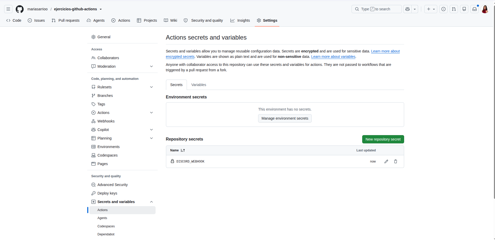
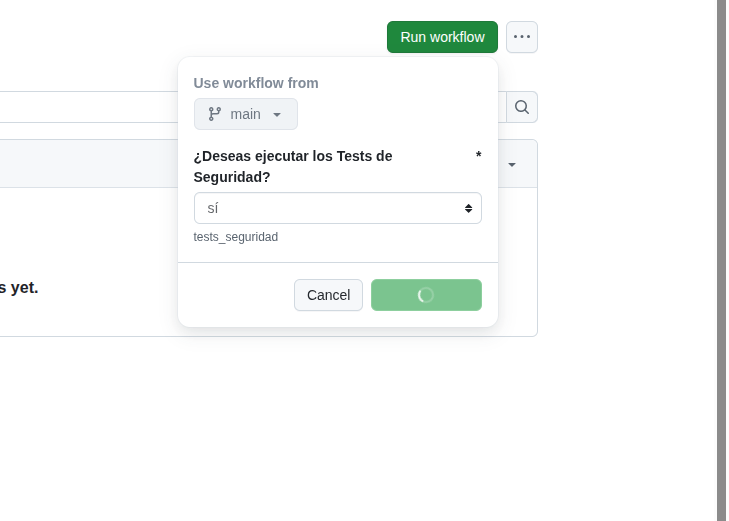
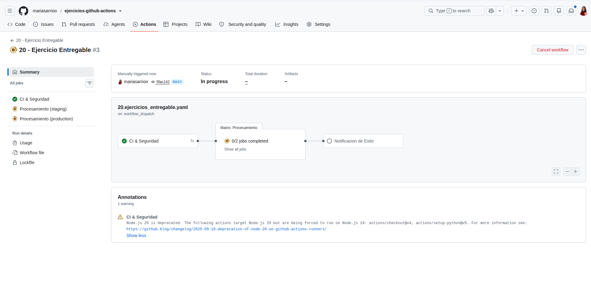
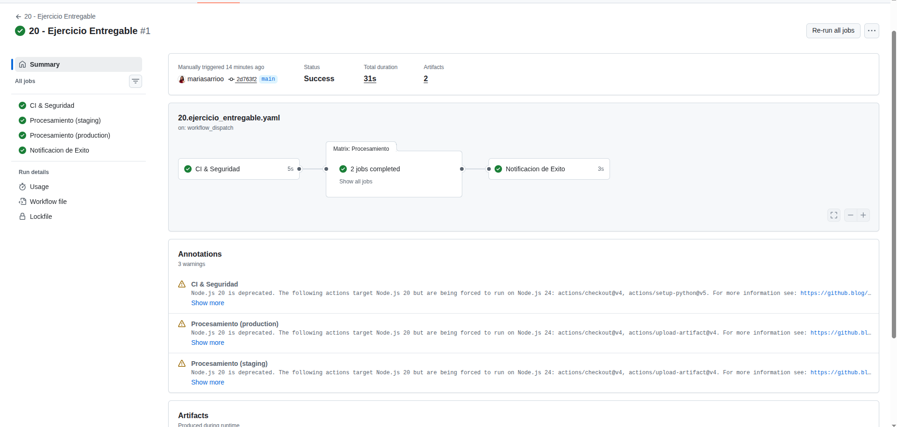
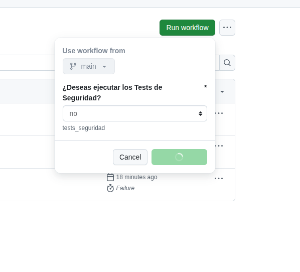
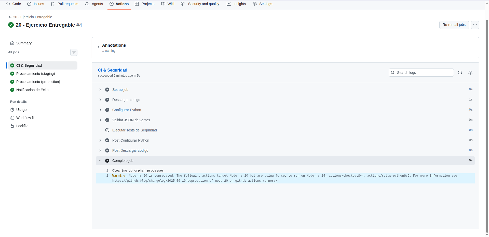

# GitHub Actions - Entregable

## 1. Activación del workflow

Se ha creado el workflow `20.ejercicio_entregable.yaml`, que se ejecuta manualmente mediante `workflow_dispatch` y permite elegir si se ejecutan los tests de seguridad (sí/no).

## 2. Job 1: CI & Seguridad

- Ejecución en `ubuntu-latest`.
- Validación del archivo `ventas.json`.
- Ejecución condicional del script `security_scan.py` para simular la detección de claves API expuestas.

## 3. Job 2: Procesamiento

Se utiliza una estrategia Matrix para ejecutar el procesamiento en dos entornos:

- Staging.
- Production.

## 4. Job 3: Notificación de Éxito

Se utiliza el secreto `DISCORD_WEBHOOK` para simular el envío de una notificación a Discord mediante un comando `echo`.

## 5. Comprobación de las ejecuciones

Se han realizado dos ejecuciones para comprobar el funcionamiento del parámetro de seguridad:

**Primera ejecución: tests de seguridad activados (sí).**

**Segunda ejecución: tests de seguridad desactivados (no).**

El paso de seguridad aparece como `Skipped`, mientras que el resto del pipeline finaliza correctamente.

## 6. Resultado final

Las dos ejecuciones han finalizado correctamente (`Success`).

Se han generado los siguientes artefactos:

- `reporte-staging`
- `reporte-production`

